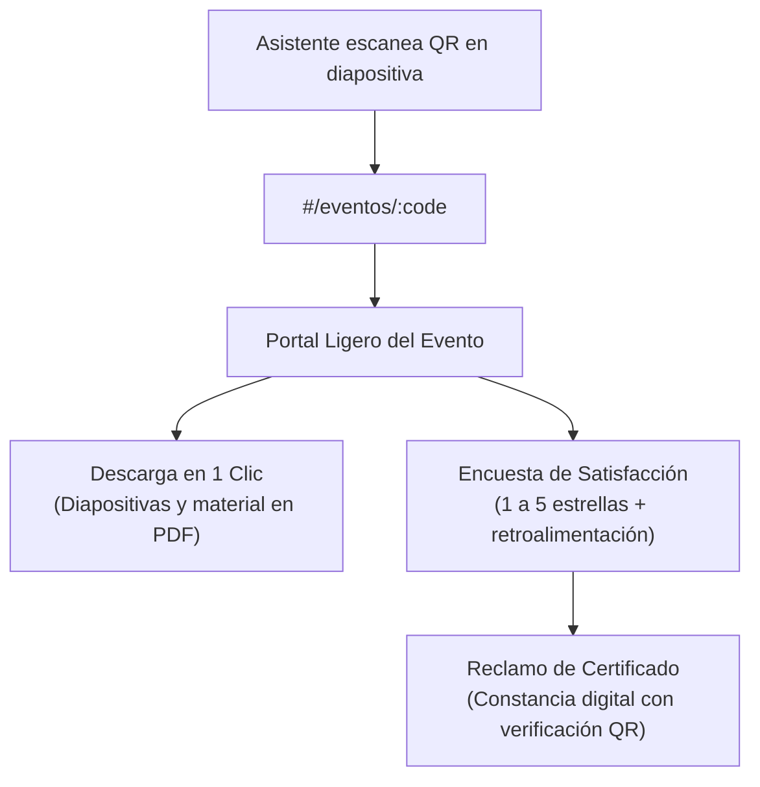
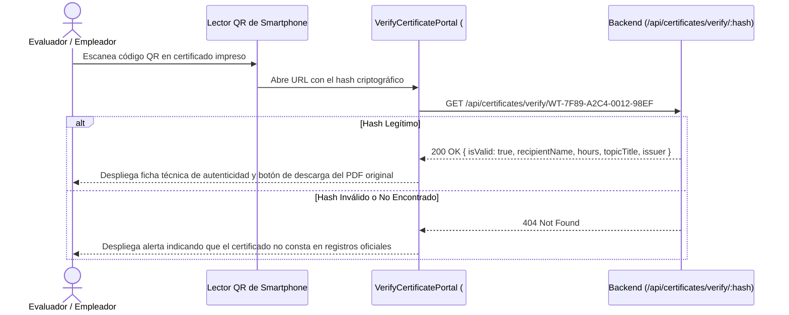

# Portales Públicos sin Autenticación y Verificación de Certificados

El sistema expone mecanismos de acceso público que no requieren que el usuario posea una cuenta ni inicie sesión, garantizando máxima velocidad, interoperabilidad y cero fricción administrativa:

---

## 1. Portal Ligero de Eventos y Conferencias (`#/eventos/:code`)

### Propósito Operativo:
Diseñado específicamente para ser proyectado en pantallas y diapositivas durante charlas, seminarios y conferencias organizadas por el Ing. Wilfrido Trujillo. Los asistentes escanean el código QR con su teléfono y aterrizan instantáneamente en esta vista ligera.



### Componentes Clave:
* **Tarjeta de Materiales:** Botón para la descarga directa de diapositivas en PDF y guías de trabajo.
* **Formulario de Retroalimentación:** Escala de 1 a 5 estrellas y caja de comentarios opcionales (`POST /api/events/public/:code/feedback`).
* **Solicitud de Certificado:** Entrada de identificación para generar la constancia oficial de participación.

---

## 2. Validador Público de Certificados Criptográficos (`#/certificados/validar/:hash`)

### Propósito Operativo:
Permite a reclutadores, comités de evaluación e instituciones educativas verificar la autenticidad formal de un certificado emitido por el Ing. Wilfrido Trujillo, leyendo la matriz QR impresa en el documento o navegando a su URL única.



### Elementos Visuales del Validador (`VerifyCertificatePortal.tsx`):
1. **Sello Oficial de Acreditación:** Estado de verificación en línea con indicación de legitimidad.
2. **Ficha Técnica del Titular:** Nombre del beneficiario en mayúsculas, cédula de identidad, horas de capacitación acreditadas y fecha de expedición.
3. **Firma y Responsable:** Certificación suscrita digitalmente por el Ing. Wilfrido Trujillo.
4. **Descarga de Evidencia:** Enlace directo para obtener una copia idéntica del archivo PDF oficial emitido.

---

## 3. Acceso Interactivo Directo desde el Tablero Bento (`LandingBentoHub.tsx`)

Para no depender exclusivamente de la cámara de un dispositivo móvil, la tarjeta número 3 del tablero principal de la aplicación incorpora un formulario de consulta inmediata:

```tsx
{/* Formulario de Consulta Rápida de Cristal en Portada */}
<form onSubmit={handleVerifySubmit} className="flex flex-col gap-2.5">
  <input
    type="text"
    value={certInput}
    onChange={(e) => setCertInput(e.target.value)}
    placeholder="Código institucional..."
    className="w-full px-3.5 py-2.5 rounded-xl bg-white/[0.08] border border-white/20 focus:border-white/50 text-xs text-white placeholder-white/40 outline-none backdrop-blur-md transition-all font-mono"
  />
  <button
    type="submit"
    className="w-full inline-flex items-center justify-center gap-2 px-4 py-2.5 rounded-xl bg-white/20 hover:bg-white/30 text-white text-xs font-semibold border border-white/30 backdrop-blur-md shadow-xs active:scale-95 transition-all cursor-pointer"
  >
    <Search className="w-3.5 h-3.5" />
    <span>Consultar Acreditación</span>
  </button>
</form>
```

### Flujo de Consulta Directa:
1. El usuario introduce el código impreso o hash del certificado (ejemplo: `WT-2026-CERT-01`).
2. La interfaz previene el envío por defecto (`e.preventDefault()`) y activa el callback `onVerifyCertificate(query)`.
3. El enrutador transiciona de forma inmediata a la ruta `#/certificados/validar/:hash`, consultando en tiempo real el estado en el backend sin recargar la aplicación.
