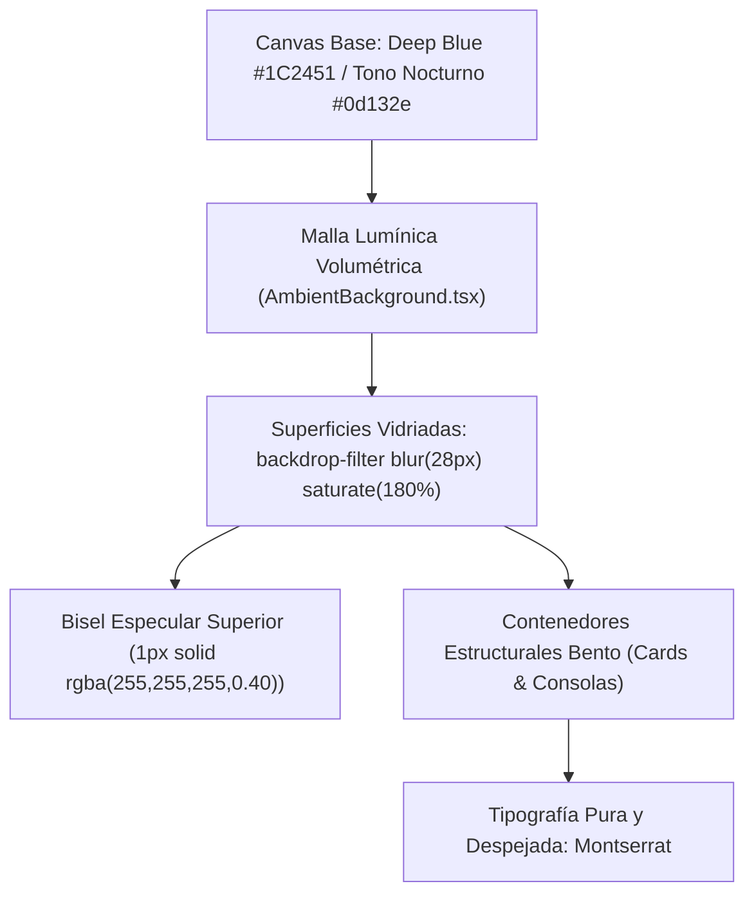

# Sistema de Diseño Glassmorphism Estructural Puro UX/UI

## 1. Fundamento y Filosofía de Diseño

El ecosistema digital `wilfrido_trujillo` implementa un sistema visual **Pure Structural Glassmorphism UX/UI** (cristal esmerilado de alta refracción física), fundamentado en la paleta cromática canónica de 5 tonos extraída directamente de los estándares oficiales de diseño en Figma.

Este estándar unifica todas las capas visuales de la plataforma (Landing Page, Tablero Bento Hub, Suite Bar, Sidebar unificado, Command Bar, Tablas de entregas, Repositorio de recursos, Evaluación formativa y Portales públicos de eventos y certificados QR), eliminando completamente estilos planos residuales y logrando una estética visual translúcida, tridimensional y sobria.



### Principios Rectores Inviolables

1. **Tipografía Oficial Única (Montserrat):** Toda la plataforma se rige por una única familia tipográfica canónica: **Montserrat** (pesos 300 Light, 400 Regular, 500 Medium, 600 SemiBold, 700 Bold, 800 ExtraBold, junto a sus variantes cursivas). Se descarta el uso de tipografías genéricas del navegador o mezclas arbitrarias de fuentes.
2. **Glassmorphism Estructural Puro (Sin Cercos en Palabras ni Íconos):** El efecto vidriado aplica única y exclusivamente a superficies y contenedores estructurales completos (tarjetas Bento, consolas de datos, modales de dictamen, barras de navegación). Queda terminantemente prohibido colocar alrededor de palabras, subtítulos, frases o íconos SVG cualquier elemento que los rodee (cápsulas `rounded-full`, píldoras, óvalos, bordes perimetrales, fondos translúcidos o discos decorativos). Las palabras descansan libres y limpias sobre la superficie con tipografía pura, y los íconos se muestran sin cajas ni cercos.
3. **Malla Lumínica Volumétrica Subyacente (`AmbientBackground.tsx`):** La translucidez del cristal depende físicamente de fuentes lumínicas subyacentes. El fondo global incorpora una composición óptica de orbes difusos de alta luminancia (luz cenital blanco hielo/zafiro con `blur-[130px]`, orbe lateral índigo/cian con `blur-[120px]`, orbe lateral plata/violeta con `blur-[125px]` y orbe inferior de contención), refractando a través de los paneles vidriados con `backdrop-blur-2xl`.
4. **Relieve Especular y Bisel Superior:** Cada tarjeta vidriada presenta un bisel superior reflectivo (`border-top: 1px solid rgba(255, 255, 255, 0.40)`) y sombra interior de luz (`box-shadow: inset 0 1px 1px 0 rgba(255, 255, 255, 0.28)`), emulando la incidencia cenital de luz sobre vidrio real.
5. **Cero Emojis:** Comunicación e interacción 100% tipográfica sobria e iconografía funcional mínima (`lucide-react`) reservada estrictamente a affordance interactivo.
6. **Cero Palabras Innecesarias ni Redundancia:** Máxima economía textual. Prohibido duplicar información entre títulos, barras de progreso y descripciones dentro de un mismo componente.

---

## 2. Matriz Cromática Canónica de 5 Colores

La totalidad de la interfaz se construye sobre la interacción de los 5 colores del sistema:

| Token Semántico | Valor Hexadecimal | Rol en el Sistema | Uso Canónico en la Interfaz |
| :--- | :--- | :--- | :--- |
| **Blue** | `#1C2451` | Lienzo / Canvas Base | Fondo global del documento, tinte base de paneles vidriados y modales. |
| **Grey** | `#F0F0F3` | Superficie Clara / Texto Base | Texto de cuerpo legible, datos tabulares, affordance interactivo. |
| **Black** | `#33383D` | Carbón / Dark Contrast | Respaldos de alto contraste, capas de sombra ambiental y dropdowns. |
| **Dark Grey** | `#C4C4C4` | Metadatos / Neutro Secundario | Subtítulos, metadatos, marcas de tiempo y placeholders de inputs. |
| **White** | `#FFFFFF` | Titulares / Reflejos Especulares | Títulos principales, destellos de bisel superior e iluminación cenital. |

---

## 3. Especificación Tipográfica Oficial: Montserrat

La tipografía Montserrat se carga desde Google Fonts en `frontend/index.html` y se configura como fuente predeterminada en `frontend/src/index.css` (`@theme --font-sans` y `:root` / `body`):

```html
<link rel="preconnect" href="https://fonts.googleapis.com" />
<link rel="preconnect" href="https://fonts.gstatic.com" crossorigin />
<link href="https://fonts.googleapis.com/css2?family=Montserrat:ital,wght@0,300;0,400;0,500;0,600;0,700;0,800;1,400;1,600&display=swap" rel="stylesheet" />
```

### Escala Jerárquica Tipográfica

| Nivel Jerárquico | Peso (Weight) | Tamaño (Tailwind) | Tracking / Interletrado | Aplicación en la Plataforma |
| :--- | :--- | :--- | :--- | :--- |
| **Display / Hero** | `700 Bold` | `text-4xl` a `text-6xl` | `tracking-tight` | Título institucional de portada ("Wilfrido Trujillo"). |
| **Título de Módulo** | `600 SemiBold` | `text-2xl` a `text-3xl` | `tracking-tight` | Encabezados de tarjetas Bento ("Prácticas Preprofesionales"). |
| **Subtítulo / Sección** | `600 SemiBold` | `text-xl` a `text-2xl` | `tracking-tight` | Módulos secundarios ("Vinculación", "Validar Certificado"). |
| **Sobretítulo / Categoría** | `600 SemiBold` | `text-xs` | `tracking-wider uppercase` | Referencias normativas puras ("Régimen Académico RRA Art. 54"). |
| **Cuerpo de Lectura** | `400 Regular` | `text-xs` a `text-sm` | `normal` | Descripciones operativas de módulos e instrucciones. |
| **Metadatos y Etiquetas** | `500 Medium` | `text-xs` / `text-[11px]` | `normal` | Subtextos informativos, cómputos y fechas. |
| **Datos Numéricos / Código** | `500 / 600 Mono` | `text-xs` | `font-mono` | Contadores de horas (`240 / 240 h`), códigos y hashes SHA-256. |

---

## 4. Tokens de Diseño CSS (Pure Glassmorphism Tokens)

Definidos en `:root` dentro de `frontend/src/index.css`:

```css
:root {
  /* Tipografía Canónica */
  font-family: 'Montserrat', system-ui, -apple-system, BlinkMacSystemFont, 'Segoe UI', Roboto, sans-serif;

  /* Colores Canónicos */
  --color-blue: #1C2451;
  --color-grey: #F0F0F3;
  --color-black: #33383D;
  --color-dark-grey: #C4C4C4;
  --color-white: #FFFFFF;

  /* Superficies Vidriadas */
  --bg-canvas: #1C2451;
  --bg-glass-card: linear-gradient(135deg, rgba(255, 255, 255, 0.10) 0%, rgba(255, 255, 255, 0.03) 100%);
  --bg-glass-card-hover: linear-gradient(135deg, rgba(255, 255, 255, 0.15) 0%, rgba(255, 255, 255, 0.05) 100%);
  --bg-glass-nav: rgba(28, 36, 81, 0.68);
  --bg-glass-sidebar: rgba(28, 36, 81, 0.52);
  --bg-glass-modal: rgba(28, 36, 81, 0.88);
  --bg-glass-input: rgba(255, 255, 255, 0.08);

  /* Bordes y Reflejos Especulares */
  --border-glass-subtle: rgba(255, 255, 255, 0.10);
  --border-glass-default: rgba(255, 255, 255, 0.18);
  --border-glass-top: rgba(255, 255, 255, 0.38);
  --border-glass-highlight: rgba(255, 255, 255, 0.32);
  --border-glass-focus: rgba(255, 255, 255, 0.60);

  /* Jerarquía de Radios Estructurales */
  --radius-sm: 8px;
  --radius-md: 14px;
  --radius-lg: 18px;
  --radius-xl: 24px;
  --radius-2xl: 32px;

  /* Sombras y Luces Especulares */
  --shadow-glass: 0 20px 50px -10px rgba(0, 0, 0, 0.50);
  --shadow-glass-hover: 0 26px 60px -10px rgba(0, 0, 0, 0.60);
  --shadow-glass-modal: 0 35px 90px rgba(0, 0, 0, 0.75);
  --shadow-specular: inset 0 1px 1px 0 rgba(255, 255, 255, 0.45);
}
```

---

## 5. Arquitectura del Tablero Bento Hub (`LandingBentoHub.tsx`)

La página principal del sistema estructura sus 4 dominios funcionales en un tablero Bento asimétrico de cristal de alta refracción, eliminando desplazamientos innecesarios y condensando las acciones críticas en una única vista panorámica:

```text
┌─────────────────────────────────────────────────────────────────────────────┐
│                            LandingHeader Vidriado                           │
│  Wilfrido Trujillo / Plataforma Académica             [ Acceder al Portal ] │
├─────────────────────────────────────────────────────────────────────────────┤
│                                                                             │
│                  INSTITUTO SUPERIOR TECNOLÓGICO · PERIODO 2026-I            │
│                              Wilfrido Trujillo                              │
│         Plataforma de supervisión académica, vinculación comunitaria        │
│                    y certificación oficial con verificación QR.             │
│                                                                             │
│  ┌──────────────────────────────────────────────┬────────────────────────┐  │
│  │ TARJETA 1 (col-span-2)                       │ TARJETA 2 (col-span-1) │  │
│  │ Prácticas Preprofesionales                   │ Vinculación            │  │
│  │ - RRA Art. 54 · 240 Horas Normativas         │ - Impacto Territorial  │  │
│  │ - Cómputo de horas con barra luminosa        │ - Supervisión activa   │  │
│  │ - [ Ingresar a Prácticas -> ]                │ - [ Ver Proyectos -> ] │  │
│  ├──────────────────────────────────────────────┼────────────────────────┤  │
│  │ TARJETA 3 (col-span-1)                       │ TARJETA 4 (col-span-2) │  │
│  │ Validar Certificado                          │ Gestión de Eventos y   │  │
│  │ - Consulta en línea de autenticidad          │ Evaluación Docente     │  │
│  │ - Input directo de código institucional      │ - PBAC Multi-Rol       │  │
│  │ - [ Consultar Acreditación ]                 │ - Eventos y Seminarios │  │
│  │                                              │ - [ Acceder al Portal ]│  │
│  └──────────────────────────────────────────────┴────────────────────────┘  │
│                                                                             │
│                           LandingFooter Vidriado                            │
└─────────────────────────────────────────────────────────────────────────────┘
```

### Especificación de las 4 Tarjetas Bento

1. **Tarjeta 1: Prácticas Preprofesionales (Span 2 columnas):**
   - Presenta el marco normativo (Régimen Académico RRA Art. 54, 240 Horas Normativas).
   - Incorpora barra de progreso fáctica con cómputo reglamentario de horas y resplandor de luz blanca.
   - Botón directo para ingresar al flujo formativo del módulo.
2. **Tarjeta 2: Vinculación con la Sociedad (Span 1 columna):**
   - Resumen de impacto territorial, convenios interinstitucionales y supervisión docente activa.
   - Botón para inspeccionar el catálogo de proyectos comunitarios.
3. **Tarjeta 3: Validar Certificado con Búsqueda Interactiva (Span 1 columna):**
   - Ofrece un campo de entrada interactivo vidriado que permite ingresar un código o hash institucional directamente desde la portada sin requerir una cámara lectora de QR.
   - Al pulsar "Consultar Acreditación", redirige automáticamente a `#/certificados/validar/:hash`.
4. **Tarjeta 4: Gestión de Eventos y Evaluación Docente (Span 2 columnas):**
   - Integra accesos directos divididos en dos sub-paneles: "Eventos & Seminarios" y "Cuestionarios & Inducción".
   - Botón de acceso integral a la consola multi-rol con PBAC.

---

## 6. Malla Lumínica Volumétrica (`AmbientBackground.tsx`)

Para que el cristal esmerilado (`backdrop-blur-2xl`) exhiba profundidad física, el componente `AmbientBackground` proyecta un lienzo base nocturno (`#0d132e`) junto a una composición geométrica de orbes de luz:

```tsx
// Composición de luces volumétricas para refracción física
<div className="fixed inset-0 pointer-events-none overflow-hidden select-none z-0 bg-[#0d132e]">
  {/* Canvas Base Nocturno */}
  <div className="absolute inset-0 bg-[radial-gradient(ellipse_at_top,_#1e2a66_0%,_#11173b_50%,_#090d21_100%)]" />

  {/* Luz Cenital Central: Blanco Hielo y Azul Zafiro */}
  <div className="absolute top-[5%] left-1/2 -translate-x-1/2 w-[75vw] max-w-[950px] h-[550px] rounded-full bg-gradient-to-b from-white/30 via-[#3d5afe]/35 to-transparent blur-[130px] transform-gpu" />

  {/* Orbe Lateral Izquierdo: Azul Índigo con destello cian */}
  <div className="absolute top-[20%] -left-[10%] w-[55vw] max-w-[650px] h-[55vw] max-h-[650px] rounded-full bg-gradient-to-tr from-[#304ffe]/45 via-[#2979ff]/30 to-transparent blur-[120px] transform-gpu" />

  {/* Orbe Lateral Derecho: Plata Especular y Violeta Suave */}
  <div className="absolute top-[30%] -right-[8%] w-[50vw] max-w-[600px] h-[50vw] max-h-[600px] rounded-full bg-gradient-to-bl from-white/22 via-[#536dfe]/35 to-transparent blur-[125px] transform-gpu" />

  {/* Orbe Inferior Central: Resplandor de Contención */}
  <div className="absolute -bottom-[15%] left-[25%] w-[65vw] max-w-[750px] h-[400px] rounded-full bg-gradient-to-t from-[#1a237e]/50 via-[#121842]/60 to-transparent blur-[130px] transform-gpu" />
</div>
```

---

## 7. Criterios de Implementación y Prohibiciones Estrictas

1. **Prohibido Rodear Palabras o Íconos:** No envolver palabras en píldoras decorativas, cápsulas `rounded-full` ni colocar discos detrás de íconos vectoriales. Las palabras descansan limpias con tipografía Montserrat, y los íconos se muestran sin cajas perimetrales.
2. **Prohibido Emojis:** Ningún carácter emoji está permitido en código, interfaces, alertas ni documentación.
3. **Prohibido Adjetivos Inflados:** Se prohíbe el uso de términos comerciales ("revolucionario", "mágico", "ultra-moderno"). Toda descripción es técnica, sobria y fáctica.
4. **Prohibido Exponer Criptografía o Detalles Internos:** La interfaz para el usuario final utiliza términos operativos claros ("Validar Certificado", "Consulta de Autenticidad", "Código de Constancia"), sin exponer jerga de bajo nivel ("SHA-256", "hashes", "criptografía").
