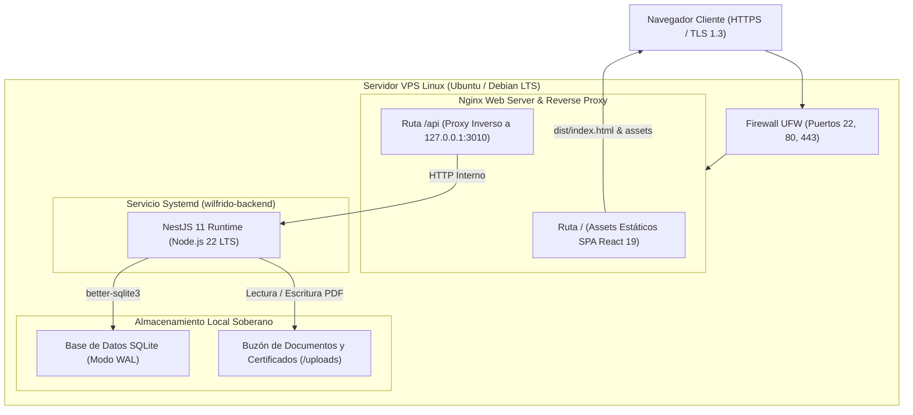

# Guía Exhaustiva de Despliegue en Servidor de Producción (VPS Linux)

Este documento especifica la arquitectura de despliegue, configuración de servicios persistentes, proxy inverso Nginx, endurecimiento de seguridad y política de respaldos para la plataforma soberana del Ing. Wilfrido Trujillo en un servidor privado virtual (VPS) bajo distribuciones Linux Debian o Ubuntu LTS.

---

## 1. Topología de Red y Arquitectura de Despliegue

El sistema opera bajo una arquitectura de alto rendimiento y bajo consumo de recursos (menos de 80 MB de RAM en reposo), combinando un servidor web estático optimizado con un servicio backend Node.js en segundo plano y persistencia embebida en SQLite WAL:



---

## 2. Requerimientos de Hardware y Software del Servidor

### 2.1 Especificaciones de Hardware Recomendadas
* **CPU:** 1 vCPU (2.0 GHz o superior).
* **Memoria RAM:** 1 GB mínimo (2 GB recomendados para procesos de compilación simultánea).
* **Almacenamiento:** 15 GB SSD o NVMe.
* **Sistema Operativo:** Ubuntu 22.04 LTS, Ubuntu 24.04 LTS o Debian 12.

### 2.2 Paquetes Base del Sistema
Conéctese al servidor mediante SSH y actualice los repositorios:

```bash
sudo apt update && sudo apt upgrade -y
sudo apt install -y curl git build-essential nginx certbot python3-certbot-nginx sqlite3 ufw
```

### 2.3 Instalación de Node.js 22 LTS y pnpm
Instale Node.js 22 a través del repositorio oficial de NodeSource y configure `pnpm`:

```bash
# Repositorio de NodeSource para Node.js 22
curl -fsSL https://deb.nodesource.com/setup_22.x | sudo -E bash -
sudo apt install -y nodejs

# Verificación de versiones
node -v # Debe mostrar v22.x.x
npm -v

# Instalación global de pnpm
sudo npm install -g pnpm
pnpm --version
```

---

## 3. Preparación del Directorio y Control de Versiones

### 3.1 Creación del Directorio de la Aplicación
```bash
sudo mkdir -p /var/www/wilfrido_trujillo
sudo chown -R $USER:$USER /var/www/wilfrido_trujillo
```

### 3.2 Clonación del Repositorio Oficial
```bash
cd /var/www
git clone https://github.com/JorgeDoicela/wilfrido_trujillo.git
cd /var/www/wilfrido_trujillo
git checkout main
```

### 3.3 Instalación de Dependencias Monorepo y Compilación
Asegúrese de compilar los módulos nativos C++ requeridos por `better-sqlite3` y `bcrypt`:

```bash
cd /var/www/wilfrido_trujillo

# Instalar dependencias con bloqueo estricto
pnpm install --frozen-lockfile

# Compilar todos los paquetes (backend dist/ y frontend dist/)
pnpm -r run build
```

---

## 4. Configuración de Variables de Entorno de Producción

### 4.1 Backend (`backend/.env`)
Cree el archivo de configuración de producción en `/var/www/wilfrido_trujillo/backend/.env`:

```env
# Servidor HTTP Interno
PORT=3010
NODE_ENV=production

# Seguridad Criptográfica JWT (PBAC)
# Generar clave de 64 caracteres hex: node -e "console.log(require('crypto').randomBytes(32).toString('hex'))"
JWT_SECRET=09add85a616dc5cbfb18a86d80a08111fc2c78e66e989a1716630fbd075659cf_CAMBIAR_EN_PROD
JWT_EXPIRES_IN=7d

# Persistencia SQLite
DATABASE_PATH=./data/wilfrido.sqlite
DB_SYNCHRONIZE=true

# Almacenamiento Local de Documentos
UPLOAD_LOCATION=./uploads
MAX_FILE_SIZE_MB=25

# Integración Institucional y Códigos QR
APP_URL=https://wilfridotrujillo.doicela.dev

# CORS Restrictivo
CORS_ORIGIN=https://wilfridotrujillo.doicela.dev
```

### 4.2 Frontend (`frontend/.env`)
Cree el archivo `/var/www/wilfrido_trujillo/frontend/.env` antes de compilar el cliente:

```env
# En producción, Nginx enruta /api directamente al backend sin especificar puerto
VITE_API_URL=/api
VITE_APP_TITLE="Wilfrido Trujillo | Gestión Académica y Eventos"
```

Tras modificar `frontend/.env`, recompile el paquete frontend para incrustar las rutas relativas de producción:
```bash
pnpm --filter frontend build
```

---

## 5. Servicio Persistente de Backend con Systemd

Para garantizar que el servicio backend NestJS se inicie automáticamente tras un reinicio del servidor y se recupere automáticamente ante cualquier excepción inesperada, se utiliza un servicio nativo de `systemd`.

Cree el archivo de unidad `/etc/systemd/system/wilfrido-backend.service`:

```ini
[Unit]
Description=Backend API REST - Plataforma Wilfrido Trujillo
After=network.target

[Service]
Type=simple
User=www-data
Group=www-data
WorkingDirectory=/var/www/wilfrido_trujillo/backend
Environment=NODE_ENV=production
ExecStart=/usr/bin/node dist/main.js
Restart=always
RestartSec=5
StandardOutput=journal
StandardError=journal
SyslogIdentifier=wilfrido-backend

# Medidas de endurecimiento de seguridad
ProtectSystem=full
ProtectHome=true
NoNewPrivileges=true

[Install]
WantedBy=multi-user.target
```

### 5.1 Permisos de Archivos y Carpetas de Almacenamiento
Asegure que el usuario `www-data` tenga permisos sobre la base de datos y la carpeta de uploads:

```bash
# Directorios de datos y uploads
sudo mkdir -p /var/www/wilfrido_trujillo/backend/data
sudo mkdir -p /var/www/wilfrido_trujillo/backend/uploads

# Asignar propiedad a www-data
sudo chown -R www-data:www-data /var/www/wilfrido_trujillo/backend/data
sudo chown -R www-data:www-data /var/www/wilfrido_trujillo/backend/uploads
sudo chmod -R 775 /var/www/wilfrido_trujillo/backend/data
sudo chmod -R 775 /var/www/wilfrido_trujillo/backend/uploads
```

### 5.2 Inicialización y Habilitación del Servicio
```bash
sudo systemctl daemon-reload
sudo systemctl enable wilfrido-backend
sudo systemctl start wilfrido-backend

# Verificar estado operativo
sudo systemctl status wilfrido-backend
```

---

## 6. Configuración del Servidor Web Nginx

Nginx actúa como punto único de entrada, sirviendo los archivos estáticos de React 19 de forma directa y redirigiendo las peticiones a la API NestJS mediante proxy inverso.

Cree el archivo de configuración en `/etc/nginx/sites-available/wilfridotrujillo.doicela.dev`:

```nginx
# ==============================================================================
# CONFIGURACIÓN NGINX PRODUCCIÓN — WILFRIDO TRUJILLO
# ==============================================================================

# Zonas de limitación de tasa (Mitigación de ataques de denegación y fuerza bruta)
limit_req_zone $binary_remote_addr zone=api_general:10m rate=30r/s;
limit_req_zone $binary_remote_addr zone=auth_limit:10m rate=5r/m;

# Redirección global HTTP a HTTPS
server {
    listen 80;
    listen [::]:80;
    server_name wilfridotrujillo.doicela.dev;
    server_tokens off;
    return 301 https://$host$request_uri;
}

# Servidor Seguro HTTPS (TLS 1.2 / 1.3)
server {
    listen 443 ssl;
    listen [::]:443 ssl;
    http2 on;
    server_name wilfridotrujillo.doicela.dev;

    # Ocultar versión del servidor (Anti-fingerprinting)
    server_tokens off;

    # Certificados SSL de Origen (Cloudflare Full / Let's Encrypt)
    ssl_certificate /etc/ssl/certs/nginx-selfsigned.crt;
    ssl_certificate_key /etc/ssl/private/nginx-selfsigned.key;

    # Parámetros estrictos de seguridad criptográfica TLS
    ssl_protocols TLSv1.2 TLSv1.3;
    ssl_prefer_server_ciphers on;
    ssl_ciphers 'ECDHE-ECDSA-AES128-GCM-SHA256:ECDHE-RSA-AES128-GCM-SHA256:ECDHE-ECDSA-AES256-GCM-SHA384:ECDHE-RSA-AES256-GCM-SHA384:DHE-RSA-AES128-GCM-SHA256:DHE-RSA-AES256-GCM-SHA384';
    ssl_session_timeout 1d;
    ssl_session_cache shared:SSL:10m;
    ssl_session_tickets off;

    # Cabeceras de seguridad HTTP endurecidas (A+ SSL Labs / SecurityHeaders)
    add_header Strict-Transport-Security "max-age=31536000; includeSubDomains; preload" always;
    add_header X-Frame-Options "SAMEORIGIN" always;
    add_header X-Content-Type-Options "nosniff" always;
    add_header X-XSS-Protection "1; mode=block" always;
    add_header Referrer-Policy "strict-origin-when-cross-origin" always;
    add_header Permissions-Policy "camera=(), microphone=(), geolocation=(), payment=()" always;

    # Límite máximo para subida de documentos (bitácoras y evidencias)
    client_max_body_size 25M;

    # Raíz del Frontend compilado (React 19 + Vite)
    root /var/www/wilfrido_trujillo/frontend/dist;
    index index.html;

    # Compresión Gzip para alto rendimiento en transferencias
    gzip on;
    gzip_vary on;
    gzip_min_length 1024;
    gzip_proxied expired no-cache no-store private auth;
    gzip_types text/plain text/css text/xml text/javascript application/x-javascript application/json application/xml font/woff2 font/woff;

    # Bloqueo de acceso a archivos y carpetas ocultas (.git, .env, .sqlite)
    location ~ /\. {
        deny all;
        access_log off;
        log_not_found off;
    }

    # Enrutamiento SPA con soporte para Hash Routing (#/) y rutas directas
    location / {
        try_files $uri $uri/ /index.html;
    }

    # Caché estática agresiva para assets versionados por Vite (Inmutables)
    location /assets/ {
        expires 1y;
        add_header Cache-Control "public, immutable";
    }

    # Proxy Inverso para el endpoint sensible de autenticación (Anti-bruteforce)
    location = /api/auth/login {
        limit_req zone=auth_limit burst=3 nodelay;
        proxy_pass http://127.0.0.1:3010/api/auth/login;
        proxy_http_version 1.1;
        proxy_set_header Host $host;
        proxy_set_header X-Real-IP $remote_addr;
        proxy_set_header X-Forwarded-For $proxy_add_x_forwarded_for;
        proxy_set_header X-Forwarded-Proto $scheme;
    }

    # Proxy Inverso general para la API REST de NestJS
    location /api/ {
        limit_req zone=api_general burst=20 nodelay;
        proxy_pass http://127.0.0.1:3010/api/;
        proxy_http_version 1.1;
        proxy_set_header Upgrade $http_upgrade;
        proxy_set_header Connection 'upgrade';
        proxy_set_header Host $host;
        proxy_set_header X-Real-IP $remote_addr;
        proxy_set_header X-Forwarded-For $proxy_add_x_forwarded_for;
        proxy_set_header X-Forwarded-Proto $scheme;
        proxy_cache_bypass $http_upgrade;
        
        # Timeouts de lectura y escritura para procesamiento de PDFs
        proxy_read_timeout 60s;
        proxy_connect_timeout 60s;
    }

    # Servir archivos estáticos subidos de forma segura
    location /uploads/ {
        alias /var/www/wilfrido_trujillo/backend/uploads/;
        expires 7d;
        add_header Cache-Control "public";
        
        # Prohibir ejecución de scripts en la carpeta de evidencias
        location ~ \.(php|pl|py|jsp|sh|cgi|exe|bat)$ {
            deny all;
        }
    }
}
```

### 6.1 Habilitación del Sitio y Validación de Sintaxis
```bash
sudo ln -sf /etc/nginx/sites-available/wilfridotrujillo.doicela.dev /etc/nginx/sites-enabled/
sudo nginx -t
sudo systemctl reload nginx
```

---

## 7. Configuración de TLS de Extremo a Extremo (Cloudflare + Nginx)

El subdominio `wilfridotrujillo.doicela.dev` opera con proxy de Cloudflare activo (`Proxied`) en modo de cifrado **Full** (o **Full Strict** con Origin CA), garantizando tráfico HTTPS cifrado desde el navegador hasta Cloudflare y desde Cloudflare hacia el puerto `443` del VPS:

1. **En Cloudflare DNS:**
   * Registro `A`: Nombre `wilfridotrujillo`, apuntando a la IPv4 pública del VPS con estado `Proxied`.
2. **En el Servidor Debian (Certificado TLS de Origen):**
   ```bash
   sudo openssl req -x509 -nodes -days 3650 -newkey rsa:2048 \
     -keyout /etc/ssl/private/nginx-selfsigned.key \
     -out /etc/ssl/certs/nginx-selfsigned.crt \
     -subj "/CN=wilfridotrujillo.doicela.dev"
   sudo chmod 600 /etc/ssl/private/nginx-selfsigned.key
   ```

---

## 8. Reglas de Red y Cortafuegos (AWS Security Group & UFW)

Tanto en el firewall de red del proveedor Cloud (AWS Security Group / Lightsail Networking) como en el firewall de host (`ufw`), deben habilitarse exclusivamente los tres puertos operativos:

* `22/tcp` (SSH — Administración y despliegue desde GitHub Actions)
* `80/tcp` (HTTP — Redirección 301 hacia HTTPS)
* `443/tcp` (HTTPS — Tráfico productivo TLS 1.2/1.3)

```bash
sudo ufw default deny incoming
sudo ufw default allow outgoing
sudo ufw allow 22/tcp
sudo ufw allow 80/tcp
sudo ufw allow 443/tcp
sudo ufw enable
sudo ufw status verbose
```

---

## 9. Política y Script de Respaldo Automatizado (SQLite WAL)

> [!IMPORTANT]
> En bases de datos SQLite en modo WAL, **nunca copie directamente el archivo `.sqlite` con `cp` en caliente**, ya que las transacciones activas se encuentran en los archivos acompañantes `.sqlite-wal` y `.sqlite-shm`. Utilice siempre la utilidad nativa de online backup (`.backup`).

### 9.1 Script de Respaldo (`/usr/local/bin/backup-wilfrido.sh`)
Cree el script con permisos de ejecución:

```bash
sudo nano /usr/local/bin/backup-wilfrido.sh
```

Pegue el siguiente contenido:

```bash
#!/bin/bash
set -euo pipefail

BACKUP_DIR="/var/backups/wilfrido"
DATE=$(date +"%Y%m%d_%H%M%S")
DB_SRC="/var/www/wilfrido_trujillo/backend/data/wilfrido.sqlite"
DB_DEST="${BACKUP_DIR}/wilfrido_db_${DATE}.sqlite"
UPLOADS_SRC="/var/www/wilfrido_trujillo/backend/uploads"
UPLOADS_DEST="${BACKUP_DIR}/uploads_${DATE}.tar.gz"

mkdir -p "$BACKUP_DIR"

# 1. Respaldo seguro en caliente de SQLite WAL
if [ -f "$DB_SRC" ]; then
    sqlite3 "$DB_SRC" ".backup '${DB_DEST}'"
    gzip "${DB_DEST}"
fi

# 2. Respaldo comprimido de evidencias y certificados
if [ -d "$UPLOADS_SRC" ]; then
    tar -czf "${UPLOADS_DEST}" -C "$(dirname "$UPLOADS_SRC")" "$(basename "$UPLOADS_SRC")"
fi

# 3. Retención de respaldos: eliminar archivos con más de 30 días de antigüedad
find "$BACKUP_DIR" -type f -mtime +30 -name "wilfrido_*" -delete
```

Haga el script ejecutable:
```bash
sudo chmod 750 /usr/local/bin/backup-wilfrido.sh
```

### 9.2 Programación en Crontab
Configure una tarea diaria a las 02:00 AM con registro de salida en `/var/log/wilfrido-backup.log`:

```cron
# Respaldo diario en caliente de SQLite WAL y evidencias PDF a las 02:00 AM
0 2 * * * /usr/local/bin/backup-wilfrido.sh >> /var/log/wilfrido-backup.log 2>&1
```

---

## 10. Pipeline CI/CD Automatizado con GitHub Actions

El proyecto cuenta con integración y despliegue continuo en `.github/workflows/ci.yml` y `.github/workflows/deploy.yml`:

1. **Compilación Remota en GitHub (`build-and-test`):**
   * Ejecuta análisis estático (`pnpm -r run lint` con Oxlint), suite de pruebas unitarias (`pnpm --filter backend run test` con Vitest) y compilación de producción (`pnpm -r run build`) en los servidores de GitHub Actions, evitando consumir memoria RAM de compilación en el VPS Debian.
2. **Aprovisionamiento y Despliegue vía SCP/SSH (`deploy`):**
   * Garantiza de forma idempotente la activación de un archivo Swap de 2 GB (`/swapfile`) registrado en `/etc/fstab` para proteger instancias VPS de 1 GB de RAM frente a picos de memoria.
   * Transfiere únicamente los artefactos compilados (`backend/dist/`, `frontend/dist/`, manifiestos `package.json` y `pnpm-lock.yaml`) hacia `/var/www/wilfrido_trujillo/`.
   * Sincroniza dependencias de producción (`pnpm install --prod --frozen-lockfile`), aplica la configuración endurecida de Nginx y Systemd, reinicia `wilfrido-backend`, audita que el `MainPID` permanezca fijo e invariable tras el intervalo de reinicio de Systemd (`RestartSec=5`) y verifica que el puerto local `3010` responda con `200 OK` antes de concluir la ejecución.

### 10.1 Corpus Académico Inicial (`DatabaseCorpusSeederService`)
Al iniciar el servicio por primera vez (o sobre cualquier base de datos existente de manera 100% idempotente), `DatabaseCorpusSeederService` aprovisiona un corpus completo para demostración, auditoría y operación inmediata:
* **Estudiantes Sembrados (Contraseña `Estudiante123*`):** `0600000002`, `0604128934` (Camila Cevallos), `0605219483` (Mateo Hidalgo), `0603891042` (Valeria Moreno) y `0604782319` (Andrés Paredes).
* **Evaluaciones Normativas (`Test`):** Bancos de 5 preguntas técnicas RRA para `PRAC-2026` y `VINC-2026`.
* **Plantillas y Guías Descargables (`ResourceFile`):** 6 documentos PDF reales generados en `./uploads/resources/` para `PRAC-2026`, `VINC-2026` y `CONF-IA`.
* **Expedientes Auditados (`DocumentSubmission`):** 4 entregas con PDFs reales en `./uploads/documents/` y dictámenes del Auditor Heurístico RRA cubriendo los 3 estados del semáforo (`passed` con 96/100 y 92/100, `warning` con 68/100 y `rejected` con 28/100).
* **Certificados Verificables (`Certificate`):** Códigos públicos `WT-2026-CONF-8A4F`, `WT-2026-PRAC-9B2C` y `WT-2026-VINC-3D7E` listos para validación inmediata en `/#/certificados/validar/:hash`.

### Secretos de Repositorio Requeridos en GitHub Actions
* `VPS_HOST`: Dirección IPv4 pública del servidor Debian.
* `VPS_USERNAME`: Usuario SSH del servidor (ej. `admin`).
* `VPS_SSH_KEY`: Clave privada SSH en formato PEM/OpenSSH.
* `VPS_SSH_PORT`: Puerto SSH del servidor (`22` por defecto).

